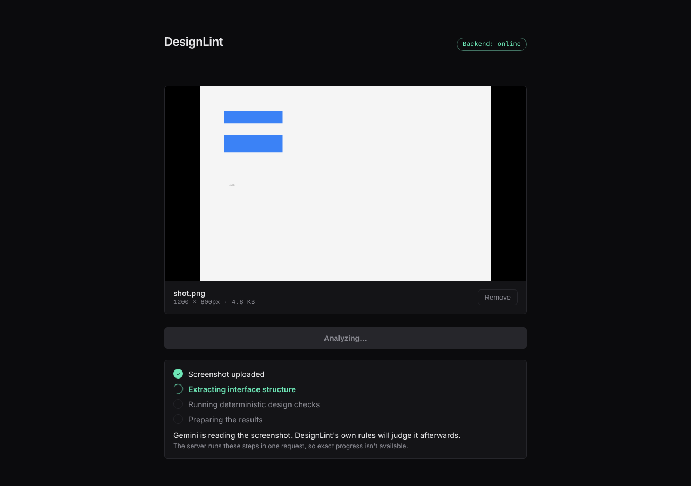
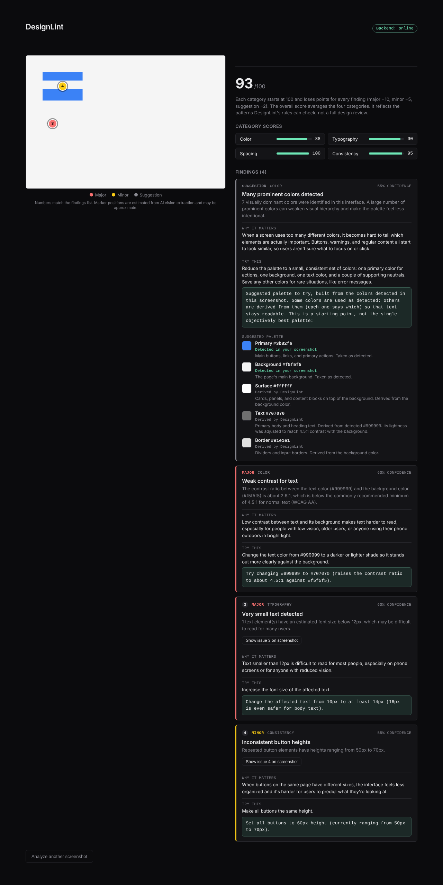
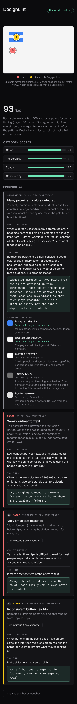

# DesignLint

DesignLint reviews a screenshot of a website or app and returns specific, beginner-friendly design feedback: a score, a list of findings with numbered markers on the screenshot, and concrete things to try.

It is a portfolio project. It checks a small set of observable design patterns with deterministic rules. It is **not** a replacement for a professional accessibility or UX audit.

## The problem

Students and developers who focus on code often ship interfaces with avoidable design problems (weak text contrast, too many colors, tiny text, uneven spacing) and have no mentor to point them out. DesignLint tries to give that first round of feedback, with a reason and a suggested fix for each issue.

## Main features

- Upload a PNG, JPG or WEBP screenshot (up to 10 MB by default).
- Findings in four categories: Color, Typography, Spacing, Consistency. Each has a severity, a confidence value, why it matters, and what to try.
- A real WCAG 2.x contrast-ratio check between text and background colors (4.5:1 threshold for normal text).
- A suggested palette built from the colors detected in the screenshot. Each entry says whether it was **detected** or **derived** (for example, a text color whose lightness was adjusted to reach 4.5:1).
- An annotated screenshot: numbered markers linked to the findings list.
- A score out of 100 that can be explained by hand: each category starts at 100 and loses 10 / 5 / 2 points per major / minor / suggestion finding.

## How it works

```
Screenshot upload
  -> Gemini visual extraction        (what is on the screen)
  -> normalization and validation    (clean up Gemini's output)
  -> deterministic rule engine       (what is wrong)
  -> findings and scoring
  -> recommendation layer            (what to try)
  -> React results page
```

**Gemini sees, DesignLint judges.** Gemini is only asked to *perceive*: list the UI elements, approximate bounding boxes, estimated font sizes and dominant colors (with optional role labels). It is never asked whether the design is good. All judgments, severities, scores and recommendations come from plain Python code in `backend/app/rules/`, `scoring.py` and `recommendations.py`. The same extraction always produces the same findings, score and palette, and the rules are unit-tested without calling Gemini.

Because Gemini's wording varies between runs (`"body text"` vs `"body_text"`, `"font size"` vs `"estimatedFontSize"`), a normalization layer (`schemas/normalization.py`) and a sanitizing validator (`services/validation.py`) absorb that variation. Individual malformed elements or colors are dropped rather than failing the whole request.

## Tech stack

- Backend: Python, FastAPI, Pydantic v2, `google-genai` 0.3.0 (pinned on purpose), pytest
- Frontend: React 19, Vite, oxlint
- Model: `gemini-2.5-flash` (extraction only)

## Local setup

You need Python 3.12+ and Node 20.19+ (or 22.12+, required by Vite 8), plus a Gemini API key from Google AI Studio.

### Backend

```bash
cd backend
python -m venv venv
source venv/bin/activate            # Windows: venv\Scripts\activate
pip install -r requirements.txt
cp .env.example .env                # then add your own GEMINI_API_KEY
uvicorn app.main:app --reload --port 8000
```

Check `http://localhost:8000/api/health` returns `{"status":"ok", ...}`.

### Frontend

```bash
cd frontend
npm install
cp .env.example .env
npm run dev
```

Open the printed URL (usually `http://localhost:5173`).

### Environment variables

| File | Variable | Purpose |
| --- | --- | --- |
| `backend/.env` | `GEMINI_API_KEY` | Your Gemini key. Stays on the server; never put it in the frontend. |
| `backend/.env` | `CORS_ORIGINS` | Comma-separated browser origins allowed to call the API (default `http://localhost:5173`). Set this to your real frontend URL when deploying. |
| `backend/.env` | `MAX_UPLOAD_SIZE_MB` | Upload limit enforced by the backend (default 10). The frontend shows a matching 10 MB message; if you change the backend value, update `MAX_SIZE_BYTES` in `UploadDropzone.jsx` too. |
| `frontend/.env` | `VITE_API_BASE_URL` | Backend URL (default `http://localhost:8000`). |

`.env` files are git-ignored; only the `.env.example` files are tracked.

## Tests and checks

```bash
cd backend
pytest tests/ -v          # 115 tests, no Gemini key needed (Gemini is mocked)

cd ../frontend
npm run lint
npm run build
```

There is no frontend test suite yet.

## Screenshots

These were captured from the real frontend while a mock server returned a result computed by the real backend rules from a hand-written sample extraction (not from a live Gemini call).

| Analysis progress | Results (desktop) | Results (mobile) |
| --- | --- | --- |
|  |  |  |

## Security notes

- The backend checks the upload's real file signature (PNG/JPEG/WEBP), not just the browser-reported type, and enforces the size limit itself.
- Error responses are generic: no API keys, config values, paths or stack traces. Details go to the server log only.
- CORS is limited to the configured origins and to GET/POST.
- There is no authentication, rate limiting or storage. Add rate limiting before exposing a public deployment, because every analysis calls the Gemini API under your key.

## Known limitations

- Gemini's bounding boxes, font sizes and colors are estimates, so findings are worded as "possible" and marker positions can be off.
- The rules cover only: color count, text/background contrast, font-size variety and minimum size, heading hierarchy, vertical spacing variance, and size consistency of buttons/cards. They do not check layout, alignment, images, motion, keyboard behavior, screen-reader support, or color-blindness.
- The contrast check only runs when Gemini labels both a text color and a background color. Otherwise it reports nothing rather than guessing.
- Light vs dark detection falls back to average color luminance when no background label exists, which can misjudge some screenshots.
- A suggested palette is a starting point derived from detected colors, not an objectively best palette.
- Findings and scores are not validated against professional audits or user research, and there are no accuracy benchmarks.
- No frontend automated tests; the UI was checked manually at desktop and mobile widths.
- The analysis is a single request with no live stage reporting, so the progress screen is an honest approximation, not exact progress.

## Possible future improvements

- Streaming or polling stage updates from the backend.
- Frontend component tests and automated accessibility checks.
- More rules (alignment, touch-target size, color-blind simulation).
- Rate limiting and deployment configuration.
- Saving and comparing past analyses.

## Project structure

```
backend/
  app/
    main.py                     FastAPI app + CORS
    config/                     settings.py, scoring.py (all score numbers)
    routes/                     health.py, analyze.py
    services/                   gemini_service, validation, rule_engine,
                                scoring, recommendations, color_utils
    schemas/                    extraction, findings, normalization
    rules/                      color, contrast, typography, spacing, consistency
  tests/
frontend/
  src/pages/AnalyzerPage.jsx
  src/components/{upload,analyzer}/
  src/services/api.js
docs/screenshots/
```
